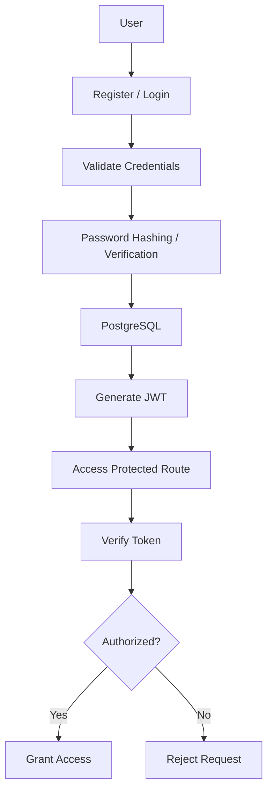

# Employee Authentication API

A RESTful Employee Management and Authentication API built using **Node.js, Express.js, and PostgreSQL**. This project implements secure user registration, password hashing, JWT authentication, protected routes, and role-based authorization.

## Technologies Used

- Node.js and Express.js
- PostgreSQL and node-postgres (`pg`)
- bcrypt and JSON Web Token
- dotenv
- Jest and Supertest
- Nodemon

## Features

- Employee CRUD operations.
- PostgreSQL connection pooling.
- User registration and login.
- Secure password hashing using bcrypt.
- JWT token generation and verification.
- Protected user profile endpoint.
- Role-based authorization (Student and Admin).
- Input validation and parameterized SQL queries.
- Automated API testing.

## Project Structure

```text
employee-auth-api/
├── migrations/
│   ├── 001_create_employees.sql
│   ├── 002_check_employees.sql
│   ├── 003_add_department_index.sql
│   └── 004_create_users.sql
├── src/
│   ├── config/
│   ├── controllers/
│   ├── middleware/
│   ├── models/
│   ├── routes/
│   └── server.js
├── tests/
│   ├── employee.test.js
│   └── auth.test.js
├── .env
├── .gitignore
├── package.json
└── README.md
```

## Installation and Setup

**1. Clone the repository**

```bash
git clone https://github.com/pranaycharde01/20-Days-Web-Development-Training.git
```

**2. Navigate to the project**

```bash
cd 20-Days-Web-Development-Training/Day11/employee-auth-api
```

**3. Install dependencies**

```bash
npm install
```

**4. Configure environment variables**

Create a `.env` file:

```env
PORT=5000
DB_HOST=localhost
DB_PORT=5432
DB_NAME=postgres
DB_USER=postgres
DB_PASSWORD=your_postgresql_password
JWT_SECRET=your_secure_random_secret
```

Execute the SQL migration files in PostgreSQL. Never commit `.env` to GitHub.

**5. Start the server**

```bash
npm run dev
```

API URL: `http://localhost:5000`

## API Endpoints

### Authentication

| Method | Endpoint | Description |
|---|---|---|
| POST | `/api/auth/register` | Register a user |
| POST | `/api/auth/login` | User login |
| GET | `/api/auth/profile` | Get user profile |
| GET | `/api/auth/admin` | Admin-only access |

### Employee Management

| Method | Endpoint | Description |
|---|---|---|
| GET | `/api/employees` | Get all employees |
| GET | `/api/employees/:id` | Get employee by ID |
| POST | `/api/employees` | Create employee |
| PUT | `/api/employees/:id` | Update employee |
| DELETE | `/api/employees/:id` | Delete employee |

### Other Endpoints

| Method | Endpoint | Description |
|---|---|---|
| GET | `/` | API health check |
| GET | `/api/health` | Database health check |

## Authentication Flow

1. User registers with name, email, and password.
2. Password is hashed using bcrypt and stored in PostgreSQL.
3. During login, credentials are verified.
4. A JWT token is generated after successful login.
5. The token is verified when accessing protected routes.
6. User roles are checked before granting restricted access.



## Security

- Passwords are hashed using bcrypt.
- JWT tokens expire after one hour.
- JWT issuer and audience are verified.
- JWT secret is stored in environment variables.
- Protected routes require valid tokens.
- Role-based access control is implemented.
- Parameterized SQL queries help prevent SQL injection.
- Environment credentials are excluded from GitHub.

## Automated Testing

Run tests using:

```bash
npm test
```

**Test Results:**

| Test Suite | Passed |
|---|---:|
| Employee API | 5 |
| Authentication API | 6 |
| **Total** | **11/11** |

All 11 automated tests passed successfully using Jest and Supertest.

## Learning Outcomes

- REST API development with Express.js.
- PostgreSQL database integration.
- Password hashing and JWT authentication.
- Role-based authorization.
- Protected API routes and middleware.
- Automated API testing.

## Author

**Pranay Charde**

GitHub: [pranaycharde01](https://github.com/pranaycharde01)

**Project:** Day 11 – Authentication and Authorization  
**Program:** 20-Day Web Development Training
